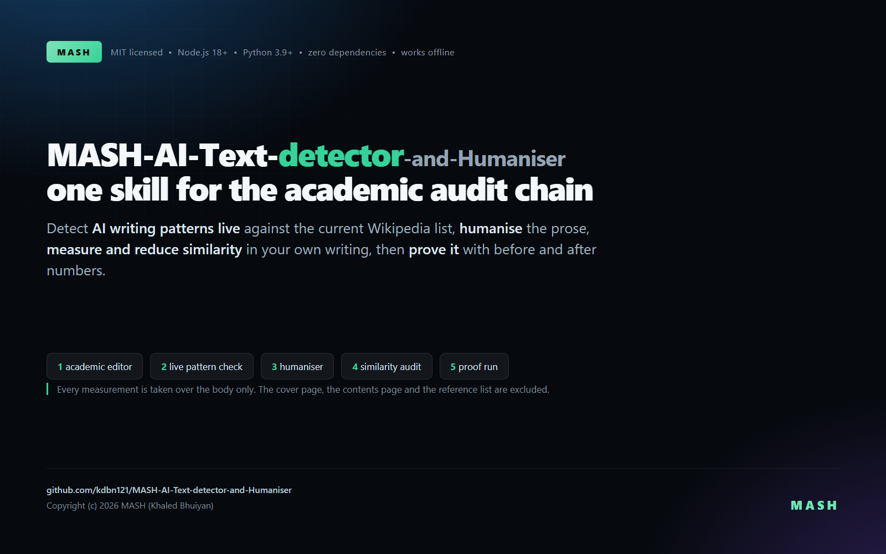
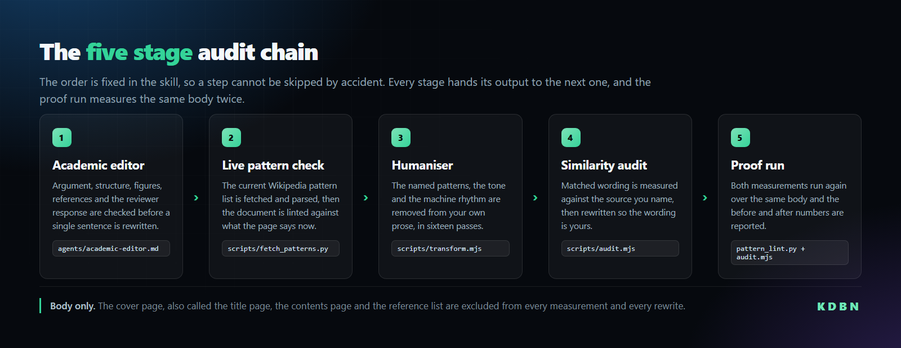
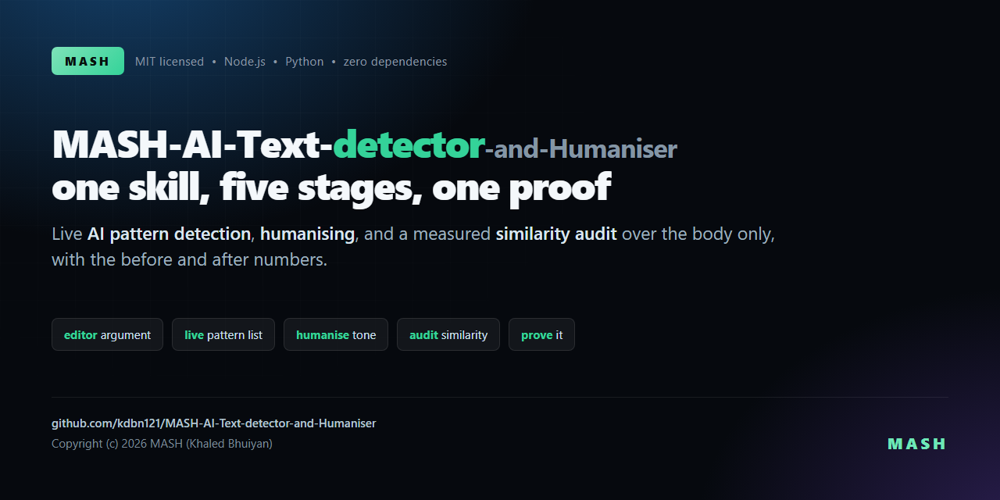

<p align="center">
  
</p>

<p align="center">
  <a href="https://github.com/kdbn121/MASH-AI-Text-detector-and-Humaniser/actions/workflows/ci.yml"></a>
  <a href="LICENSE"></a>
  
  
  
  
  
</p>

# MASH AI Text detector and Humaniser

**One skill for the whole academic writing audit chain: detect the AI writing patterns live, humanise the prose, measure and reduce the similarity, then prove it with numbers.**

This repository merges three components that used to live apart into a single agent skill:

| Stage | Component | What it does |
| --- | --- | --- |
| 1 | `academic-editor` | Argument, structure, figures, references, reviewer response |
| 2 | `live-ai-pattern-check` | Fetches the live Wikipedia pattern list and lints against it |
| 3 | `ai-text-humanizer` | Removes the named AI patterns, the tone and the machine rhythm |
| 4 | `plagiarism-minimiser-kdbn` | Measures matched wording in your own prose and rewrites it |
| 5 | proof run | Runs both measurements again over the same body and reports before and after |

<p align="center">
  
</p>

## Why this exists

Three tools in a chain is three chances to forget a step. The order is fixed in the
skill, the body scope is fixed in the code, and the final proof run is part of the
procedure rather than something you have to remember to ask for.

The pattern list is the part that used to rot. The Wikipedia page "Signs of AI
writing" is edited by anyone at any time, so a stored copy of it is wrong within
weeks. This skill fetches the live page on every run and rebuilds the list from the
page itself, then lints the document against what the page says now.

## Install

The skill is a folder with a `SKILL.md` in it. Copy it into the skills folder of the
agent you use.

```bash
git clone https://github.com/kdbn121/MASH-AI-Text-detector-and-Humaniser.git
```

Then place the folder where your agent looks for skills:

| Agent | Location |
| --- | --- |
| Claude Code | `~/.claude/skills/MASH-AI-Text-detector-and-Humaniser` |
| OpenAI Codex | `~/.codex/skills/MASH-AI-Text-detector-and-Humaniser` |
| opencode | `~/.config/opencode/skill/MASH-AI-Text-detector-and-Humaniser` |
| MiniMax Code | `C:\Users\imalp\.minimax\skills\MASH-AI-Text-detector-and-Humaniser` |

Requirements: Node.js 18 or newer for the similarity engine, Python 3.9 or newer for
the live pattern scripts. Neither needs a third party package.

## Quick start

```powershell
# 1. pull the live pattern list and lint the body
python scripts/fetch_patterns.py --force
python scripts/pattern_lint.py "assignment.docx" --no-title-page-no-refs

# 2. measure the similarity against your source
node scripts/audit.mjs "assignment.docx" --source "source.txt"

# 3. rewrite your own prose and apply it to the document
node scripts/transform.mjs "assignment.docx" --out "assignment-rewritten.docx" --source "source.txt" --intensity standard
node scripts/rewrite-docx.mjs "assignment.docx" --out "assignment-rewritten.docx" --plan "assignment.plan.json"

# 4. prove it, over the same body
python scripts/pattern_lint.py "assignment-rewritten.docx" --no-title-page-no-refs
node scripts/audit.mjs "assignment-rewritten.docx" --source "source.txt"
```

## The scope rule that matters

Every measurement is taken over the **body only**. The cover page, also called the
title page, the contents page and the reference list are excluded from the lint, from
the similarity audit and from every rewrite.

That is not a preference. A reference list quoted in full is a perfect match by
definition, and a cover page carries no prose, so counting either one inflates the
figure without telling you anything about your writing.

The flag is named for the page it removes:

```
--exclude-title-page       drop the cover page and the contents page
--exclude-references       drop the reference list
--no-title-page-no-refs    both of the above
```

The older names `--exclude-front` and `--no-front-no-refs` still work as aliases.

## What the live check does

1. **Fetch.** Pulls the raw wikitext of
   `https://en.wikipedia.org/wiki/Wikipedia:Signs_of_AI_writing`, parses the pattern
   sections and the watch word lists, and caches them for 24 hours. If the network is
   down it falls back to the cache and says so.
2. **Lint.** Checks the document against the live list, the local rule sets and the
   typography rules, then reports the sentence length variation, the discourse marker
   repetition and the forced lists of three. Exit code 0 means clean, 1 means findings,
   2 means nothing was linted.
3. **Check.** Extracts the body, writes paste ready chunks for the free checkers,
   attempts the endpoints that can be called without an account, and writes a
   `.live-check.json` record.

## Honest limits

- A checker that cannot be reached is reported as a **failure**, with the reason and
  the manual command in `references/live-checkers.md`. No score is ever invented.
- No detector score can be guaranteed. The classifiers are private and their
  thresholds move without notice.
- The similarity figure is an estimate against the source you give it. It is not a
  Turnitin score and it does not predict one.
- A clean lint means the known patterns are absent. It is not a certificate of
  authorship.
- This skill is for your own academic prose. It will not disguise work you did not
  write, and it never rewrites a quotation, because rewriting a quotation turns it
  into an unattributed paraphrase.

## Repository layout

```
MASH-AI-Text-detector-and-Humaniser/
  SKILL.md                     the merged skill, the five stages and the fixed order
  README.md                    this file
  CHANGELOG.md                 what changed in each version
  CONTRIBUTING.md              how to contribute
  SECURITY.md                  how to report a problem
  LICENSE                      MIT
  package.json                 metadata for the skill package
  agents/
    academic-editor.md         stage one of the chain
  scripts/                     the engine, the citation tools, the live pattern scripts
  rules/                       the word banks, the writing rules, the humaniser catalogue
  references/                  the full procedures and the checker routes
  examples/                    a sample source, a plan file and the control sample
  docs/images/                 the photo card, the social preview and the chain diagram
  .github/                     CI, issue templates, pull request template, code owners
```

## The scripts

| Script | Runtime | Purpose |
| --- | --- | --- |
| `audit.mjs` | Node | Matched chains against the source, invisible Unicode, rhythm, trigger phrases |
| `transform.mjs` | Node | The sixteen stage rewriting engine over your own prose |
| `rewrite-docx.mjs` | Node | Applies a plan to a Word file and applies the six formatting rules |
| `justify-docx.mjs` | Node | Justifies body paragraphs and reference entries without touching the words |
| `format-docx.mjs` | Node | The six document formatting rules on their own |
| `audit-citations.mjs` | Node | In text citations against the reference list, both ways |
| `format-citations.mjs` | Node | Applies one named citation style |
| `detector-pressure.mjs` | Node | The four signal families the detector vendors publish |
| `purge.mjs` | Node | Strips invisible Unicode and content credential parts |
| `selftest.mjs` | Node | The self test for the whole engine |
| `lint-skill.mjs` | Node | Checks that every script and word bank is present and valid |
| `fetch_patterns.py` | Python | Fetches the live Wikipedia pattern list |
| `pattern_lint.py` | Python | Lints a document against the live list, body only |
| `live_checkers.py` | Python | Prepares the body for the live checkers and attempts the endpoints |

## Continuous integration

Every push runs the engine self test, the skill linter and the live pattern lint
against the control sample in `examples/`. The control sample is deliberately
machine flavoured, so the lint has to report findings on it. A lint that returns
nothing on that file is a broken lint, and CI says so.

## Images

| | |
|---|---|
|  | The social preview image. Upload it separately under **Settings > General > Social preview**, it is not shown in the README. |

Project images live in `docs/images/`. The HTML sources and the render script live in
`docs/images/source/`, so you can change the colours or wording and regenerate them:

```bash
python docs/images/source/render_images.py
```

The script finds Chrome or Chromium on the machine, renders each source to a PNG,
and prints a pass or fail line for every image.

## Keywords

AI writing detection, AI detector, humanise text, humanizer, AI pattern checker,
Wikipedia signs of AI writing, academic integrity, plagiarism checker, similarity
check, similarity report, Turnitin, paraphrasing, citation audit, Harvard referencing,
docx, agent skill, Claude Code skill, Codex skill, opencode skill, MIT licence,
offline, zero dependencies, English academic writing, Word document, batch audit.

## Licence

MIT. Copyright (c) 2026 MASH (Khaled Bhuiyan).

## Links

- Live pattern source: <https://en.wikipedia.org/wiki/Wikipedia:Signs_of_AI_writing>
- Repository: <https://github.com/kdbn121/MASH-AI-Text-detector-and-Humaniser>
- Owner: <https://github.com/kdbn121>
